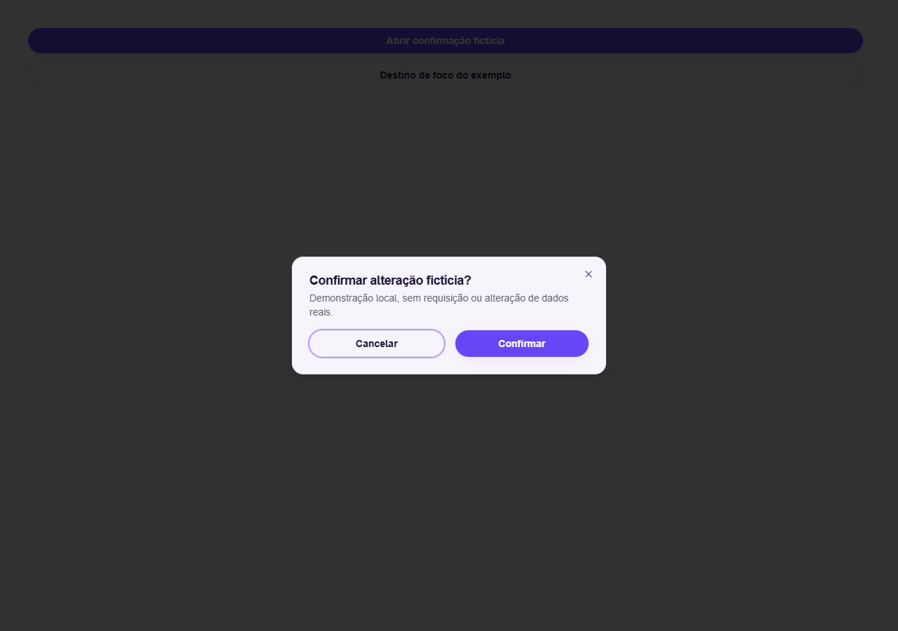
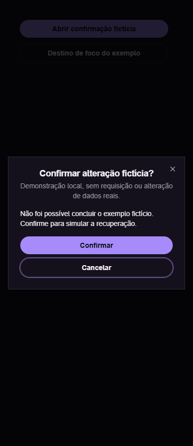
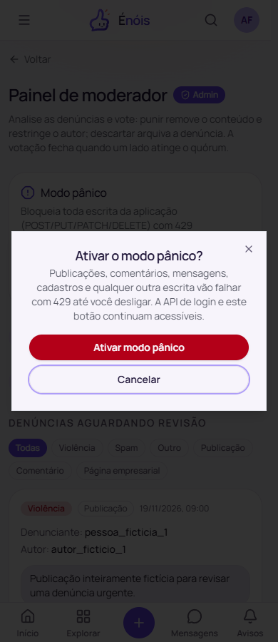

# Contrato de `ConfirmDialog`

Importação pública: `@rede-enois/design-system/ui`.

`open`, `onOpenChange`, `title`, `description`, `confirmLabel` e `onConfirm` continuam
obrigatórios. O consumidor controla abertura, execução e resultado da ação. Confirmar
chama `onConfirm`, sem fechar automaticamente. Cancelar solicita `onOpenChange(false)`.

| Prop opcional      | Padrão e comportamento                                                                                  |
| ------------------ | ------------------------------------------------------------------------------------------------------- |
| `cancelLabel`      | Usa `confirmDialog.cancel` das mensagens, por padrão "Cancelar".                                        |
| `destructive`      | `false`; `true` seleciona a variante destrutiva existente.                                              |
| `pending`          | `false`; bloqueia a confirmação e usa `confirmDialog.pending`, por padrão "Enviando...".                |
| `disabled`         | `false`; bloqueia a confirmação sem trocar seu rótulo por carregamento.                                 |
| `error`            | Ausente; texto não vazio aparece em `role="alert"`. Ausência ou string vazia remove o alerta.           |
| `onCloseAutoFocus` | Ausente; mantém o comportamento de foco do diálogo existente. Recebe o evento cancelável de fechamento. |

A confirmação fica desabilitada quando `pending || disabled`. Nenhum desses estados
desabilita Cancelar ou transforma cancelamento em confirmação. Um erro por si só não
bloqueia outra tentativa. A view não limpa erros, não faz requisições nem interpreta
falhas: ao tentar novamente, cancelar ou mudar de alvo, o consumidor deve atualizar
`error` para evitar mensagens de uma tentativa anterior.

Para escolher o foco após fechar, o consumidor pode chamar `event.preventDefault()`
em `onCloseAutoFocus` e focar um destino ainda montado. Sem callback, a restauração
existente não é substituída. A descrição mantém sua associação acessível ao diálogo
e recebe `break-words` para conteúdo longo sem espaços.

As stories em **UI/Diálogo de confirmação** usam dados fictícios e demonstram os
padrões, rótulos próprios, variante destrutiva, bloqueio sem carregamento, carregamento
isolado/combinado, recuperação de erro, descrição longa e foco personalizado.
`confirm-dialog.contract.test.tsx` exercita o componente real pelo entrypoint público.
A prova de classe no jsdom não mede overflow, contraste nem fala de leitor de tela;
a validação visual e a integração no consumidor são verificações separadas.

## Prova do recorte

Recorte sobre a QA do DS `9e22486d`: 2.291 testes normais e seriais, com identidades coincidentes.
Após reparar somente EOL do checkout, lint, tipos, build, `test:dist`, Storybook e
pack foram repetidos; os 3.107 membros do pacote permaneceram idênticos. Não houve
nova execução das suítes após essa reparação, nem publicação do pacote `0.41.6`.
O consumidor QA `53762f74` passou lint, tipos, 1.797 testes e build usando o candidato
local em lock temporário; o lock de entrega foi preservado e não houve drift das
demais dependências. Navegador: 68 checks no Storybook e 20 no app compilado, em
1280/390 e claro/escuro. A API do app foi simulada; não é E2E de backend real.
O menor contraste medido no Storybook, incluindo o novo alerta, foi 5,3946:1. Nenhuma fala assistiva foi testada.

