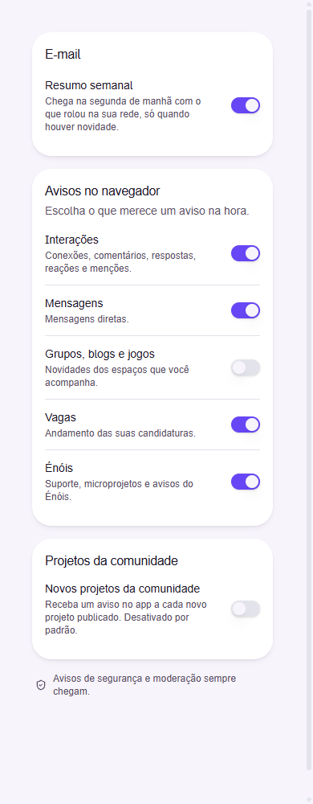
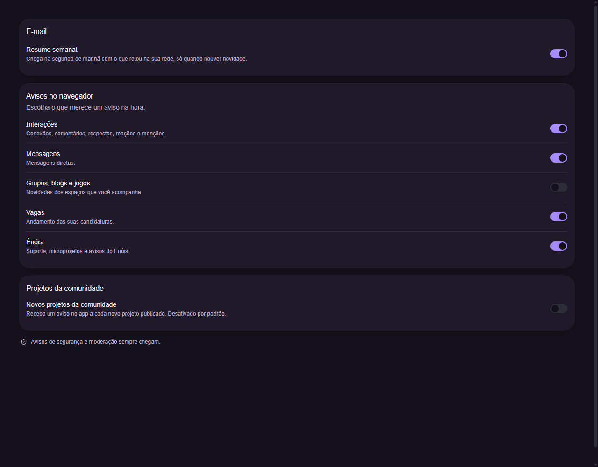

# Community project subscription: verification evidence

Origin: Rede-ENois/enois-backend#676.

## Storybook view

Story: `Domain/Notifications / Preferences Community Projects`.

The existing notification preferences view was inspected in Chromium at 390px and
1280px in light and dark mode, without horizontal overflow. The new subscription
starts off and stays independent from device push permission. These two captures
illustrate the mobile light and desktop dark layouts; they contain no account data.

### Mobile, light

### Desktop, dark

## Accessibility

Measurements used the real theme tokens in the rendered story.

| Mode  | Label/background | Hint/background |
| ----- | ---------------- | --------------- |
| Light | 17.57:1          | 7.52:1          |
| Dark  | 14.95:1          | 8.08:1          |

The existing switch has an effective 44x44px touch target. Space changed
`aria-checked` with visible keyboard focus. Label and hint associations were
checked through `aria-labelledby` and `aria-describedby`.

## Consumer validation and limits

The real frontend preferences container consumed the locally packed library.
Its lint, typecheck, 1,384 tests and production build passed. A separate HTTP
fixture exercised pending, partial writes, confirmation, rollback, loading,
read errors and an older backend without the new field.

An additional integration used that container with a real Spring Boot HTTP
server, synthetic identity and an isolated H2 database. A single keyboard action
sent one partial PUT. GET and reload retained the saved choice; a server-side
JDBC assertion confirmed persistence without changing `pushSocial`. The temporary
server test passed.

The screenshots above are Storybook evidence, not screenshots of the full app.
The consumer proofs did not exercise the complete shell/router, project
publication UI or real device push. Publication and notification delivery have
separate backend tests. No real user session or personal data was used.

The tarball contains unpublished feature code on the current library base.
It is not a published release: a maintainer must publish the coordinated package
before the frontend dependency bump and clean-install integration can be approved.
