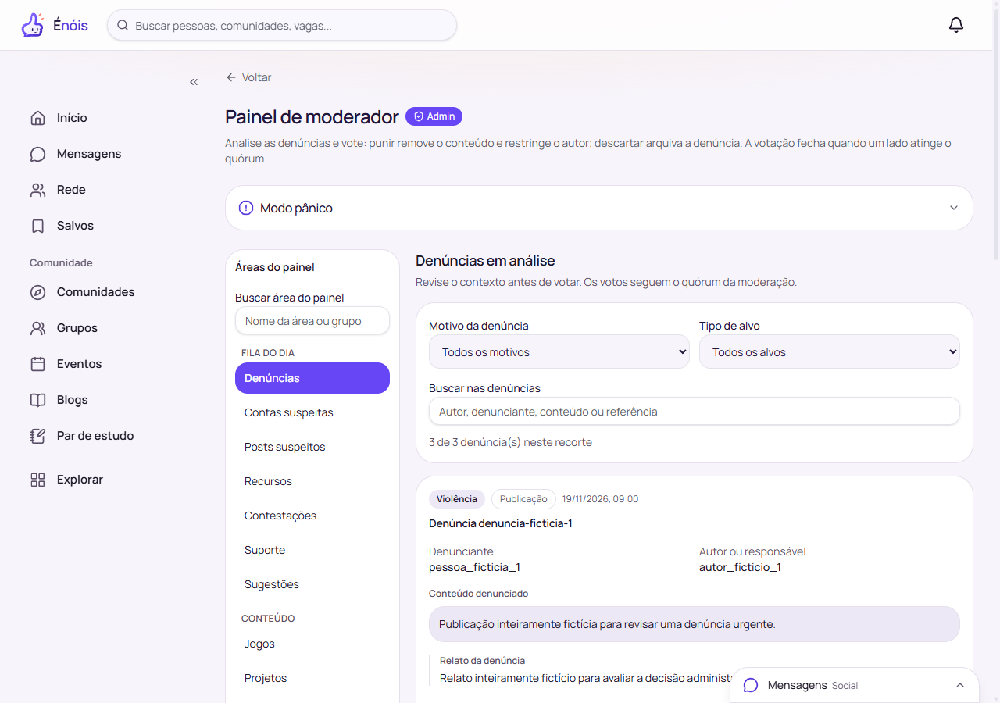
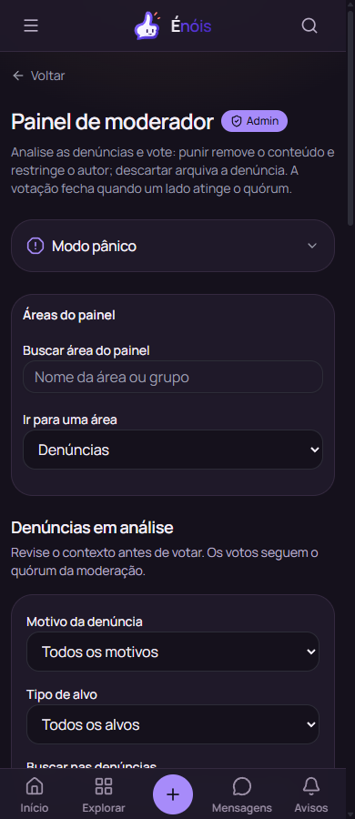
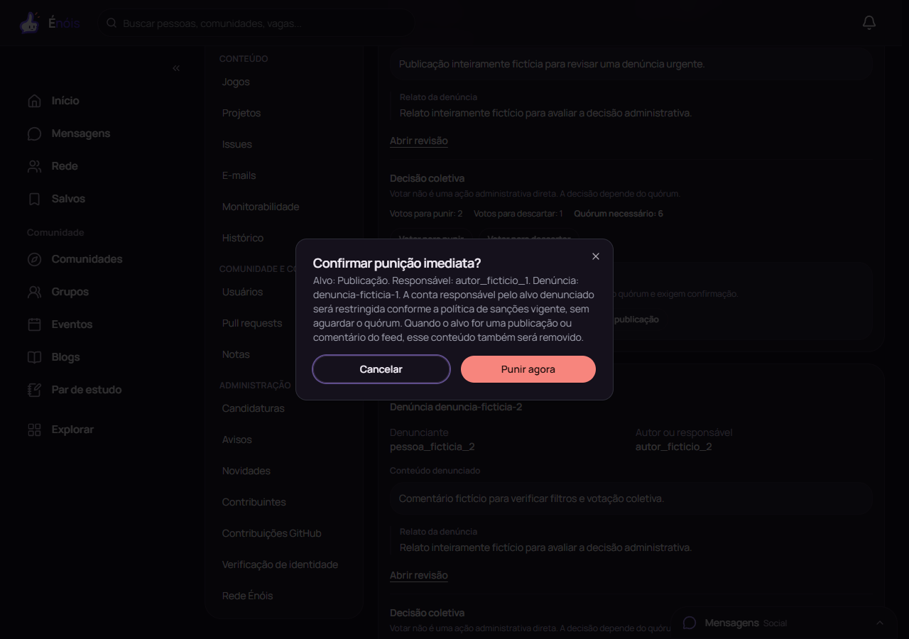
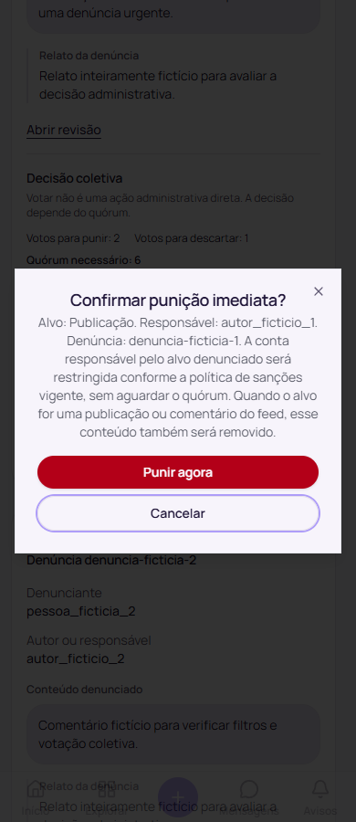

# Continuação de 19/11/2026: revisão da PR #246

## Pedido e escopo

A revisão de 17/11 pediu retirar o rascunho para revisão, executar CI, conferir a suíte serial e
anexar capturas desktop/mobile do build. Os comentários de acompanhamento da issue #245 em 19/11
confirmam que a implementação já está nesta lane: não foi criada funcionalidade ou proposta paralela.

A reconciliação preserva o quórum coletivo, a ação administrativa separada, a capacidade recebida do
consumidor, a confirmação com alvo/efeito e o estado incerto do pânico. A PR
`Rede-ENois/enois-backend#731` já foi integrada e `Rede-ENois/enois-backend#729` está fechada.
Isso não comprova implantação em produção.

## Composição e preservação

- Head anterior preservado: `44304efa190b4968fc0da292ebe9078c4e794553`.
- QA incorporada: `09da44896d7e68ad693036b673140c1d450e3dc3`.
- Reconciliação por merge na feature publicada, sem reescrever o histórico.
- Um conflito textual em `src/domain/moderation/index.ts`, resolvido pela união do workspace/fila e
  das novas views administrativas da QA. As outras cinco sobreposições também foram conferidas.
- Registros públicos e mensagens preservam os dois lados, sem colisões. Baseline idêntico à QA,
  sem aumento. Código da QA fora da feature preservado.
- Inventário final dos gates: 2038 arquivos rastreados, conferidos após a execução. Documentação e
  capturas acrescentadas depois são um delta separado das fontes exercitadas.

### Correção encontrada na revisão independente

Os dois eixos da revisão apontaram o mesmo P3, somente na story `FalhaNaAcao`: o estado externo da
demonstração reinjetava o erro de uma tentativa cancelada ao abrir outra denúncia. O consumidor
produtivo não fornecia esse estado persistente.

A reprodução falhou na asserção de erro ausente da segunda confirmação. A demonstração passou a
retornar `false` e a usar o tratamento interno já existente da view, sem alterar seu contrato. Foi
adicionado um teste pela story real com `composeStory`, sem mocks da view. RED e GREEN foram
executados; o build anterior também reproduziu o erro no navegador. A rechecagem do build final
passou em 1280/390, claro/escuro. Os pareceres originais e o delta de correção foram preservados,
sem converter a revisão anterior em aprovação retrospectiva.

## Gates finais do DS

| Gate          | Resultado                                               |
| ------------- | ------------------------------------------------------- |
| Lint          | Código 0; avisos existentes preservados                 |
| Tipos         | Código 0                                                |
| Suíte normal  | **2330 testes em 261 arquivos**, zero falhas/skips/todo |
| Suíte serial  | **2330 testes em 261 arquivos**, zero falhas/skips/todo |
| Build         | Código 0                                                |
| `test:dist`   | Código 0                                                |
| Regras ESLint | Código 0                                                |
| Storybook     | Código 0                                                |
| Pack          | Código 0                                                |

Serial: `npm test -- --no-file-parallelism --maxWorkers=1 --minWorkers=1`, com reporters JSON.
As identidades das duas suítes coincidem. A diferença para os 2329 casos anteriores é exatamente
o novo teste da story; nenhum teste foi retirado. Não somamos duas execuções dos mesmos testes.

## Pacote e consumidor

- Tarball local `0.41.4`, versão herdada da QA, **não release publicada da feature**.
- SHA-256: `3b4fc2794ee30942d69b1666c5ff6f8fbf51f2bdf9eb78f9eeb46c54d583962b`.
- O tarball final é byte a byte idêntico ao usado na prova do consumidor. O ajuste de story/teste
  não altera o pacote produtivo. Os 3137 membros foram conferidos contra a instalação no frontend;
  oito exports compilados atuais foram importados.
- Frontend #893: lint, tipos, **1810 testes em 307 arquivos** e build de produção Nitro
  `node-server` aprovados. A QA mais recente do frontend trouxe somente uma redução de baseline já
  presente na composição; a incorporação final manteve a árvore de conteúdo idêntica por hash.
- Manifestos e lockfile do consumidor permanecem os da QA, sem caminho local ou versão inventada.
  Dependências físicas e cache reutilizados não equivalem a instalação limpa pelo registro.

## Prova visual e interação

**104 verificações concluídas:** 44 do aplicativo compilado, 52 do Storybook da composição anterior
ao ajuste restrito da demonstração e oito rechecagens incrementais no Storybook final. Não é uma
única execução ininterrupta, nem 104 fluxos E2E com backend real.

As capturas abaixo são do **aplicativo real compilado com API simulada**, conta e alvos fictícios,
em 1280 × 900 e 390 × 900, claro/escuro. A API usa origem relativa e proxy exclusivamente local;
a CSP do aplicativo não foi relaxada. As imagens de viewport exigem rolagem para o conteúdo vertical
restante. A identidade do tarball permite vincular as capturas ao pacote produtivo final.

Foram exercitados: abrir/cancelar sem mutar, confirmar e reconsultar a fila, foco restaurado por
teclado, moderador sem ação administrativa e com voto coletivo, filtros, falha/retry da fila, erro
de A não herdado por B e pânico incerto bloqueado. Sem overflow horizontal nem erros JavaScript
inesperados nos estados inspecionados. HTTP 503 de consulta/ação foi deliberadamente simulado.

Contraste computado: 232 amostras no aplicativo, mínimo **5.3946:1**; 160 amostras no Storybook,
mínimo **6.0002:1**. É verificação das superfícies e controles inspecionados, não auditoria global.

As tentativas preparatórias foram preservadas: hook de console com escopo lexical repetido,
animação em aba oculta e seletores do harness. Esses problemas foram corrigidos na instrumentação,
sem mudança de produto. No consumidor, uma execução unitária recebeu indevidamente a URL absoluta
da fixture; o ambiente canônico foi restaurado e a suíte integral repetida sem mudar asserções.
Os servidores locais da prova foram encerrados após as verificações.

## Revisão e liberação

O CI aprovado em 18/11 pertence ao head anterior `44304efa`; não comprova o CI do novo head. A
atualização da PR solicita revisão e exige leitura dos novos runs. Autorização de execução por
mantenedor, revisão de conteúdo e aprovação para merge são etapas distintas.

O GitHub Packages retornou E401 sem token fornecido. Não foram buscadas credenciais em arquivos ou
em outro cliente. Publicação de RC/final e merge são ações dos responsáveis, não desta execução.
O frontend #893 continua em rascunho: depois do pacote autorizado, ainda cabem ao autor o bump
mínimo/lockfile, instalação limpa e revalidação da composição publicada. Não houve tag, publicação
de pacote ou deploy. As provas antigas permanecem identificadas como históricas.
