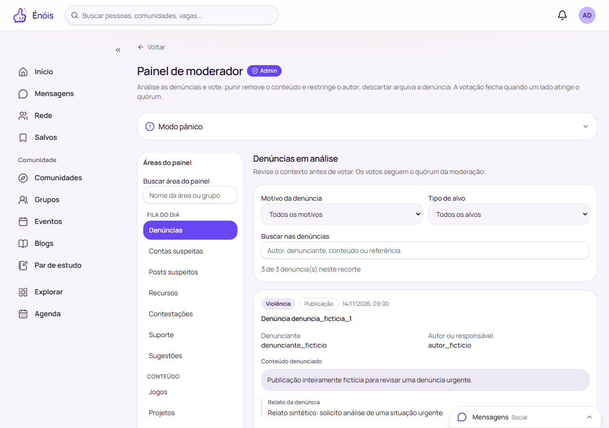
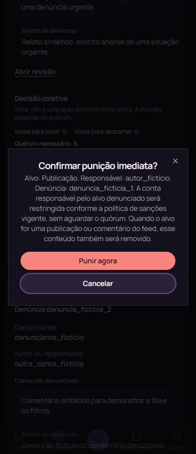

# Reconciliação da PR #246 com a QA

Verificação em **16/11/2026**, sem merge da PR, publicação de pacote ou deploy.

## Composição

- Head anterior publicado: `4fc6403b310a58dea165b7033e5898c8bf33f178`.
- QA integrada: `d602e27aaf0b691264ce4816faea62a06bf82a24`.
- Branch mantida: `feat/admin-workspace-review`.
- Integração por merge local da QA na feature publicada, preservando o head anterior como ancestral e permitindo push normal, sem reescrever histórico.
- Versão `0.37.5` e lockfile vieram da QA. Não houve bump autoral ou publicação.

## Resolução e preservação

Os quatro conflitos foram resolvidos como união explícita:

| Arquivo | Preservado |
| --- | --- |
| `README.md` | Contrato do painel, avisos da plataforma e painel de recrutamento |
| `src/domain/moderation/index.ts` | Workspace/denúncias e views administrativas diretas da QA, com seus modelos públicos |
| `src/messages/default-messages.ts` | Imports/defaults da feature e todos os domínios atuais da QA |
| `src/types/messages/messages.ts` | Imports e interseção dos contratos de mensagens de ambos os lados |

Os dois arquivos de mensagens de moderação mesclados automaticamente também foram conferidos: ações administrativas diretas atuais e erro/retry do modo pânico coexistem. Quórum, votação e política não foram alterados.

Trinta arquivos da feature fora das sobreposições conservaram bytes idênticos. Os arquivos QA fora do escopo foram comparados com a base, normalizando somente LF/CRLF, sem divergências. O delta próprio contra a QA continua com os mesmos 36 arquivos funcionais/documentais originais, acrescido somente deste registro e suas evidências.

Revisões incrementais independentes de requisitos e de padrões/segurança não encontraram achados. Escopo: os seis caminhos sobrepostos e suas ligações públicas; não é outra revisão integral da feature ou da QA. Patch funcional revisado SHA-256: `d3d58db7379644249f350cf607e7a10e2bc9eda1ed91f9ea0360df125499e253`.

## Gates desta composição do DS

| Gate | Resultado |
| --- | --- |
| `npm run lint` | Código 0; zero erros, seis avisos em arquivos não alterados pela feature |
| `npm run typecheck` | Código 0 |
| `npm test` com reporter JSON | **2146 testes em 231 arquivos**, zero falhas ou pendências |
| `npm --script-shell=bash run build` | Código 0 |
| `npm run test:dist` | Código 0 |
| `npm run test:eslint-rules` | Código 0 |
| `npm --script-shell=bash run build-storybook` | Código 0 |
| `npm pack --ignore-scripts --json` | Código 0, artefato local de prova |

Uma checagem adicional por AST confirmou a união exata de três registros de imports/exports e preservação dos spreads de defaults. Doze exports compilados foram importados no Node, incluindo as views do painel, ações administrativas diretas e domínios novos da QA. Os 2902 arquivos de `dist` instalados no consumidor coincidem com o tarball, sem divergências.

O tarball local conserva `0.37.5`, mas inclui o código desta feature; **não é o pacote publicado com esse mesmo número**. SHA-256 do artefato: `27b5e9fbeee48bc6173561b30ce6535d4482ace464cd5fe13696b6ea1caec854`.

## Consumidores: duas composições distintas

### QA atual do frontend

Worktree de teste isolado e fixado em `0ad32f6707ee4b8b26286e030a593b91cdf7c6ac`, sem portar nem publicar mudanças de frontend:

- Lint, tipos, **1554 testes em 268 arquivos** e build aprovados.
- Zero falhas ou testes pendentes; 16 avisos de lint existentes na composição.
- Dependências copiadas fisicamente e DS reconciliado instalado como artefato local. Não é instalação limpa por registro/lockfile.

### Consumidor antigo da PR #893

Head preservado: `87aa18e6973a319b7f30836e5bbdd33352e65611`.

- Lint e **25 testes focados** de painel, modo pânico e navegação aprovados.
- **Typecheck global não aprovado:** `post-card.tsx` ainda utiliza o conjunto antigo de tipos de publicação e não aceita `INSTANTE`, já presente no contrato atual da QA do DS. Esse contrato e o post card do DS não foram modificados pela resolução de conflitos.
- A cadeia global parou nesse gate; sua suíte integral e seu build não foram executados nesta composição. O sucesso da QA atual não é apresentado como aprovação desse consumidor antigo.
- O frontend da PR #893 precisa ser reconciliado com a QA antes do bump do pacote. Nenhuma fonte, commit ou PR do frontend foi alterada neste pedido.

## Navegador do painel

O consumidor da PR #893 foi exercitado em Chromium com as views reais do novo pacote, API **simulada** e dados fictícios. Isso comprova esse percurso funcional/visual, não seu typecheck global nem E2E com backend real.

- **54 checks**, incluindo **28 inspeções renderizadas**, em 390px e 1280px, claro/escuro.
- Sem overflow horizontal ou erros inesperados nos cenários da rodada concluída.
- Contraste mínimo dos textos inspecionados: **6,25:1**, sem cobrir todas as paletas.
- Busca/filtros, estados de consulta, confirmação/cancelamento, foco, operação única pendente, falha/conflito, voto coletivo e modo pânico com erro/retry exercitados.
- HTTP 503 e 409 foram deliberadamente simulados para os cenários de falha/conflito.
- Uma tentativa inicial foi descartada após erro 502 numa consulta local de chamadas abertas do shell. A repetição explicitou também esse endpoint sintético como lista vazia, sem modificar a aplicação, afrouxar asserções ou filtrar erros inesperados. Não se atribui essa falha do percurso de prova à resolução do painel.
- A rodada antiga com timeout de foco continua histórica; esta repetição não é anunciada como correção desse timeout.

Capturas desta composição, inspecionadas antes da publicação:

Os servidores próprios de prova foram encerrados e as portas locais conferidas fechadas. Logs brutos e relatórios JSON completos permanecem privados no scratch, sujeitos à retenção temporária; este resumo e as imagens são duráveis junto do código.

## Estado de liberação

**Conflitos locais resolvidos; não-pronto para merge/release.** Permanecem revisão humana e CI remoto, reconciliação do consumidor antigo, nova versão/RC publicada por mantenedor, bump coordenado e instalação limpa. Nenhum resultado local concede autorização para merge, tag, publicação de pacote ou deploy.
