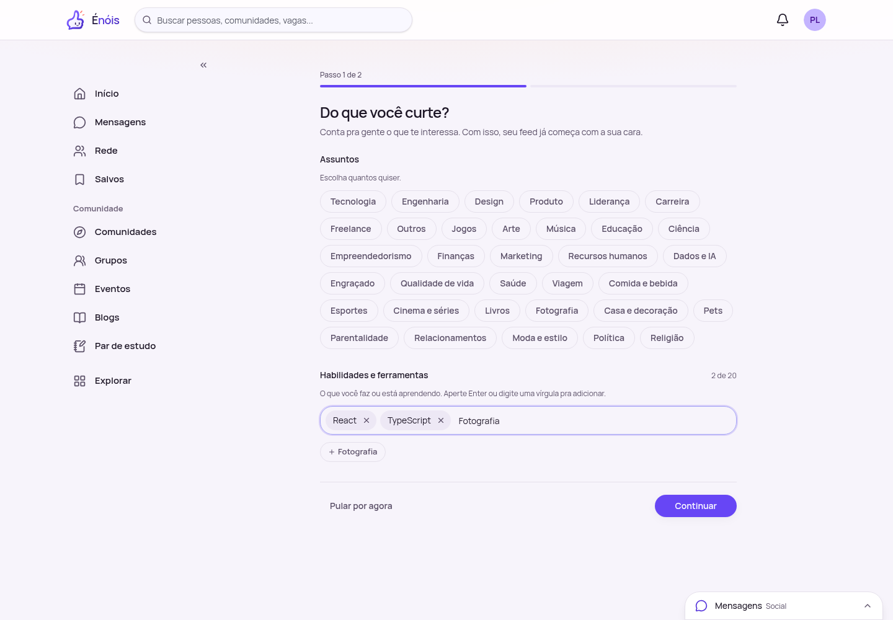
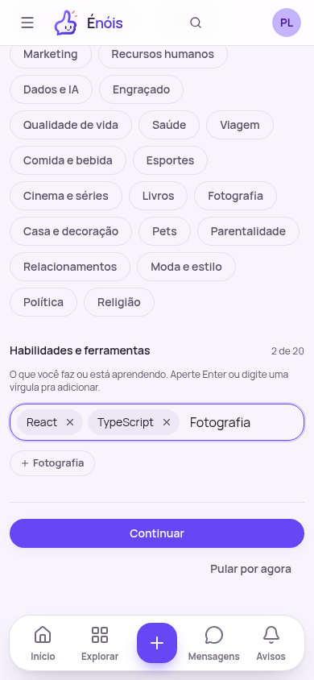
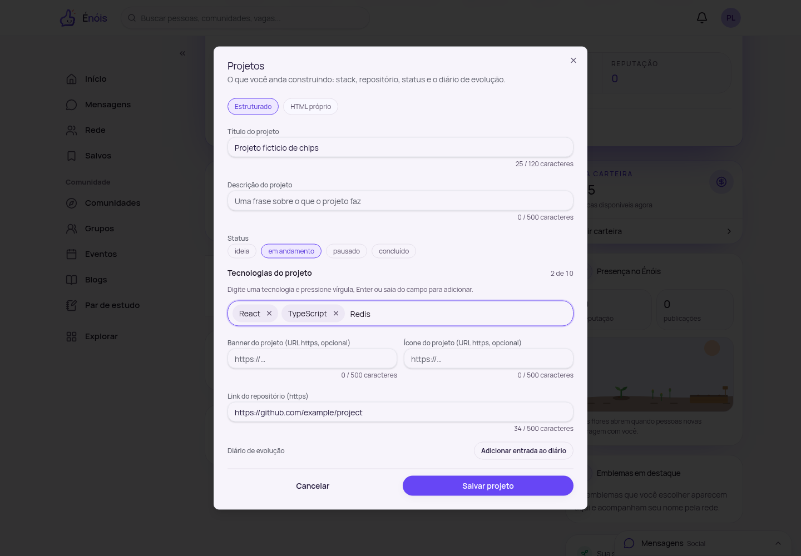
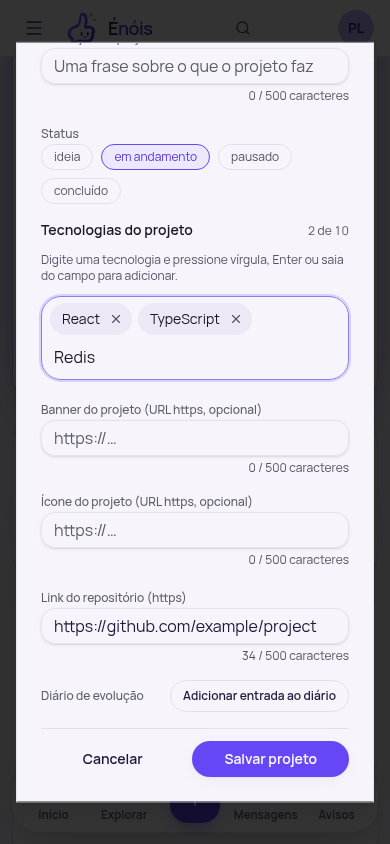

# Shared token input

Implemented for the extraction requested in design-system PR #38 and frontend
issue #360. `TokenInput` is exported from the patterns entrypoint and used by
onboarding skills (20 items, 60 characters each) and project stacks (10/40).

The existing project chip tests and `Domain/Profile/StackChips` story are retained.
New pattern tests cover Android-style comma input, pasted lists, pending drafts,
case-insensitive duplicates, limits, IME composition and focus behavior. Project
duplicates keep their existing accessible inline message; onboarding ignores
duplicates without adding another chip.
Onboarding confirms one skill per action (`allowMultiple={false}`), preserving the
original frontend callbacks. Pasting several skills shows a message and keeps the
draft available for correction without emitting additions or advancing the step.
Project stacks continue accepting comma-separated batches.
Removing a chip returns focus to the input after the controlled values update,
including when removal enables an input disabled by the item limit. Regression
tests cover both project stacks (10 items) and onboarding skills (20 items).

Verification uses the local Docker environment, H2 and fictitious accounts only.
The Chromium smoke test completes signup/email verification, fills onboarding
skills one at a time using input events, rejects a multi-skill paste without losing
the draft, advances with a pending token, then creates and edits a
profile project and checks the exact arrays sent to and returned by the API.
The action button's click must survive the input blur without a layout shift
cancelling the click. Both field layouts were checked at 390px and 1440px.

Checks: lint, typecheck, the complete design-system test suite, production build,
plain Node dist imports, Storybook build, and consumption of the packed library
by frontend lint/typecheck/tests/build. The frontend API URL unit tests run with
`BACKEND_TARGET` and `VITE_API_BACKEND` unset because they explicitly exercise the
default relative API base; the running application keeps its Docker proxy settings.
